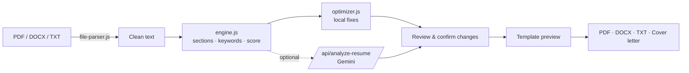

<div align="center">


# ATS Tracker Pro

**Check your resume against a job description, fix it, and export a clean ATS-friendly PDF or DOCX — mostly right in your browser.**

[](#-tech-stack)
[](#-tech-stack)
[](#-deployment)
[-8E75B2?style=for-the-badge&logo=googlegemini&logoColor=white)](#-optional-ai-tailoring)
[](#-getting-started)

[Features](#-features) · [How it works](#-how-it-works) · [Getting started](#-getting-started) · [Scoring](#-how-the-score-is-calculated) · [Project structure](#-project-structure) · [Author](#-author)

<br />


<sub>Demo video: <a href="Ats%20resume%20checker/assets/DESHboardatsmp4.mp4">assets/DESHboardatsmp4.mp4</a></sub>

</div>

---

## ✨ Overview

**ATS Tracker Pro** is a resume analyzer and builder for job seekers (built with freshers in mind). Upload a resume, paste a job description, and get:

- a **match score** with matched and missing keywords,
- a **review of spelling, grammar and weak bullets**, with every change shown before/after,
- a **tailored resume** in one of 8 templates,
- a **cover letter**, and
- **PDF / DOCX / TXT export**.

Parsing, scoring and exporting all run **client-side in plain JavaScript** — no framework, no backend needed. A small optional serverless function adds AI tailoring through Gemini.

> **Honest note:** the score is a heuristic estimate. It is not a prediction of what any real ATS or recruiter will decide.

## 🚀 Features

| | Feature | Details |
|---|---|---|
| 📄 | **Resume upload** | PDF, DOCX or TXT (max 5 MB, 15 PDF pages) or just paste the text |
| 🧠 | **Smart PDF reading** | Handles 2–3 column layouts, sidebars, small-caps fonts, wrapped URLs, icon glyphs, page footers and LinkedIn PDF exports |
| 🎯 | **JD keyword matching** | Dictionary of 120+ skills + signal-phrase detection (“experience with…”, “skills: …”), variants like `Node` / `Node.js` / `NodeJS` treated as one skill |
| 📊 | **Two modes** | *With job description* (match score) or *without* (general resume-quality score) |
| 🔍 | **Review & approve** | Line-by-line changes with checkboxes — nothing is applied until you click **Confirm Selected Changes** |
| 🤖 | **Optional AI tailoring** | Gemini rewrites the full resume under strict “never invent facts” rules; falls back to the local optimizer if unavailable |
| 🎨 | **8 resume templates** | Classic ATS, Modern Blue, Modern with Icons, Compact One-Page, Fresher: Projects First, Minimal Serif, Two-Column (left / right sidebar) |
| 🖨️ | **Auto page-fit** | Print layout is measured and tuned to fit 1 page, or 2 well-filled pages |
| 📝 | **Cover letter generator** | Built from your resume (and the JD); export as TXT, DOCX or print to PDF |
| 💾 | **Session restore** | Resume, JD and template choice are kept in `localStorage` for 7 days |
| 🔒 | **Privacy-first** | No CDN scripts — PDF.js, Mammoth and docx are vendored; strict CSP headers via `vercel.json` |

## 🧭 How it works

The UI is a 6-step wizard:

1. **Choose a mode** — with or without a job description
2. **Upload / paste** your resume
3. **Add the job description** *(skipped in “without JD” mode)*
4. **Analyze** — score, matched keywords, missing keywords, structure checks
5. **Improve & build** — review changes, confirm, pick a template, preview live
6. **Cover letter & export** — generate the letter, download PDF / DOCX / TXT



## 📐 How the score is calculated

**With a job description** (out of 100):

| Part | Weight | Notes |
|---|---|---|
| Keyword coverage | 60% | Full credit if the keyword is shown in Experience / Projects / Summary, **half credit** if it only appears in the Skills list |
| Structure checks | 25% | Contact info, Experience, Education, Projects |
| Content signals | 15% | Bullets, action verbs, measurable results |

**Without a job description:** structure 40%, length 15%, bullet quality 15%, action verbs 15%, measurable results 15%.

Keyword stuffing doesn’t pay off: a skills-only resume stays below 40 (covered by a test).

## 🛠 Tech stack

- **Frontend:** HTML, vanilla JavaScript (no framework), Tailwind CSS 3.4
- **Document handling (vendored in `assets/vendor/`):** [PDF.js](https://mozilla.github.io/pdf.js/), [Mammoth](https://github.com/mwilliamson/mammoth.js), [docx](https://docx.js.org/)
- **Serverless API:** one Vercel function (`api/analyze-resume.js`) calling the Gemini API
- **Tooling:** ESLint, Prettier, Husky, Node’s built-in test runner, GitHub Actions
- **Hosting:** Vercel (static site + serverless function)

## ⚡ Getting started

**Requirements:** Node.js 18 or newer.

```bash
# 1. Clone
git clone https://github.com/Ra-kumar4216/Ats-resume-checker-with-job-description.git
cd Ats-resume-checker-with-job-description

# 2. Install
npm install

# 3. Build the Tailwind CSS
npm run build

# 4. Run the static site locally
npm run dev
```

`npm run dev` serves the static app. The AI endpoint is **not** served by it, so the app uses the local optimizer automatically. To test the API locally, run it with the [Vercel CLI](https://vercel.com/docs/cli) (`vercel dev`).

> Open the app over `http://`, not by double-clicking `index.html`. Templates are loaded with `fetch()`, which browsers block on `file://` (a small built-in template set is used as fallback).

### Scripts

| Command | What it does |
|---|---|
| `npm run dev` | Serve `Ats resume checker/` locally |
| `npm run build` | Build minified Tailwind CSS |
| `npm test` | Run the test suite (`node --test`) |
| `npm run check` | Syntax-check every JS file |
| `npm run lint` | ESLint |
| `npm run format` / `format:check` | Prettier |

## 🤖 Optional AI tailoring

AI is **off by default**. The “Generate Tailored Resume” button always tries `/api/analyze-resume`; if no key is configured the server answers `503` and the app silently uses the local optimizer.

To enable it, set environment variables (see `.env.example`):

| Variable | Default | Purpose |
|---|---|---|
| `GEMINI_API_KEY` | — | Enables AI tailoring (kept on the server, never sent to the browser) |
| `GEMINI_MODEL` | `gemini-2.5-flash` | Model to use |
| `GEMINI_TIMEOUT_MS` | `30000` | Upstream timeout |
| `MAX_RESUME_CHARS` | `80000` | Reject larger resumes |
| `MAX_JD_CHARS` | `40000` | Reject larger job descriptions |
| `PUBLIC_SITE_URL`, `CUSTOM_DOMAIN` | — | Set before a public launch |

The prompt tells the model to preserve all true facts, never invent jobs, dates, skills or metrics, and to flag uncertain details as warnings instead of guessing.

> ⚠️ **Privacy:** when AI is enabled, the resume and JD text are sent to Google’s Gemini API. With AI disabled, nothing leaves the browser.

## ☁️ Deployment

1. Push the repo to GitHub and import it in [Vercel](https://vercel.com/).
2. Vercel runs `npm run build` (Tailwind) automatically.
3. *(Optional)* add the environment variables above.

`vercel.json` rewrites everything to the `Ats resume checker/` folder and adds security headers: `Content-Security-Policy`, `X-Frame-Options: DENY`, `X-Content-Type-Options: nosniff`, `Referrer-Policy` and `Permissions-Policy`.

## 🗂 Project structure

```text
.
├── Ats resume checker/          # Static web app
│   ├── index.html               # UI (6-step wizard)
│   ├── app.js                   # UI wiring: upload, analyze, preview, export
│   ├── engine.js                # Core logic: PDF layout → text, sections, keywords, scoring, cover letter, page-fit
│   ├── optimizer.js             # Local, deterministic grammar / spelling / bullet fixer
│   ├── skills-data.js           # Skill dictionary
│   ├── stepper.js               # Wizard navigation
│   ├── resume-icons.js          # Inline SVG / PNG contact icons
│   ├── config/app-config.js     # Limits and session settings
│   ├── services/                # api-client, file-parser, script-loader, session-store
│   ├── resume-templates/        # selector.js + 8 JSON templates
│   ├── assets/                  # Logo, demo video, vendored PDF.js / Mammoth / docx
│   └── privacy.html · terms.html
├── api/
│   ├── analyze-resume.js        # Serverless Gemini endpoint (optional)
│   ├── config.js
│   └── lib/http.js
├── test/engine.test.js          # 70 tests
├── .github/workflows/ci.yml     # check + test on every push / PR
├── vercel.json
└── package.json
```

### Add your own template

Drop a JSON file in `Ats resume checker/resume-templates/templates/` and add its filename to `MANIFEST` in `selector.js`. No other code changes are needed.

```json
{
  "id": "my-template",
  "name": "My Template",
  "description": "Short description",
  "bestFor": "Who it suits",
  "style": { "font": "Calibri, Arial, sans-serif", "accent": "#1d4ed8", "basePx": 11.5, "lineHeight": 1.45,
             "headingTransform": "uppercase", "headingRule": "1.5px solid #1d4ed8", "nameAlign": "left", "bullet": "disc" },
  "sectionOrder": ["summary", "skills", "experience", "projects", "education", "certifications"]
}
```

## ⚠️ Limitations

- Scanned (image-only) PDFs have no selectable text — paste the text instead.
- Two-column templates look good, but some strict ATS parsers misread columns; use **Classic ATS** for maximum safety.
- Keyword matching is dictionary + pattern based, so very niche skills may be missed unless they appear in a “skills: …” style list.
- The score is an estimate, not an ATS guarantee.

## 👤 Author

**Ratan Kumar** — aspiring Software Engineer / Full Stack Developer (Java, Spring Boot, React, MySQL).

[](https://github.com/Ra-kumar4216)
[](https://linkedin.com/in/ratan-kumar-metha)
[](https://ratankumar-portfolio.vercel.app)

---

<div align="center">

If this project helped you, consider giving it a ⭐

</div>
